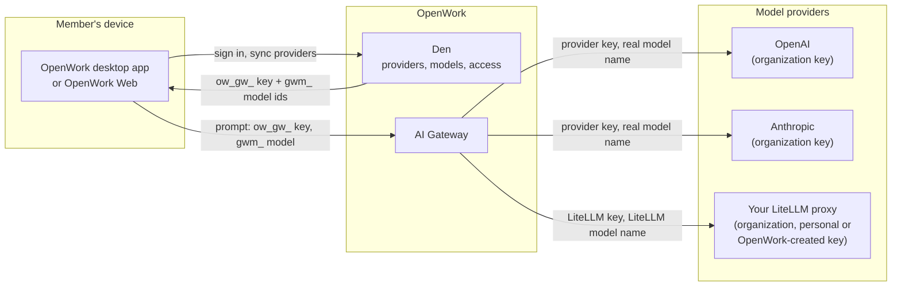
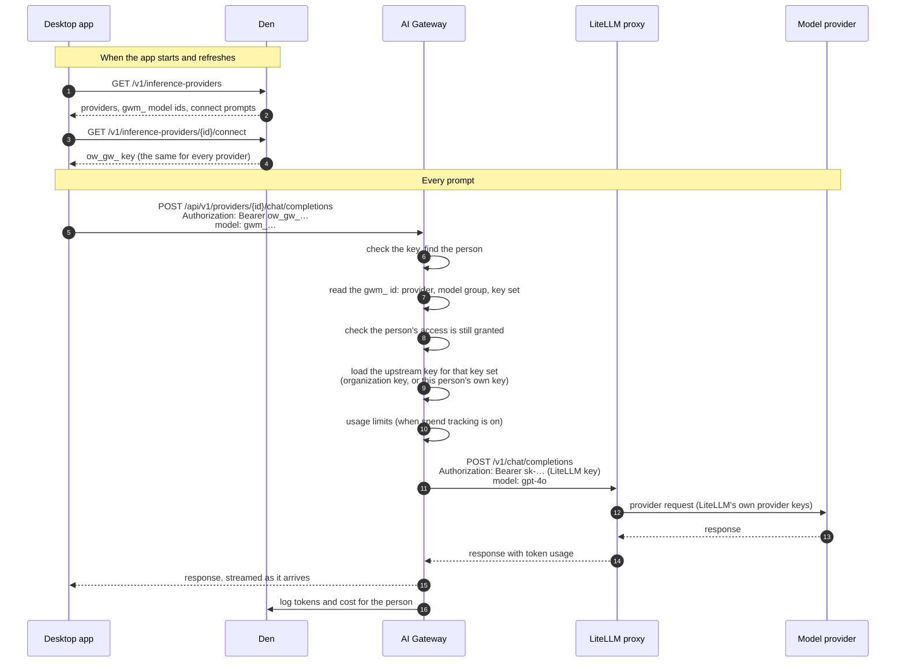
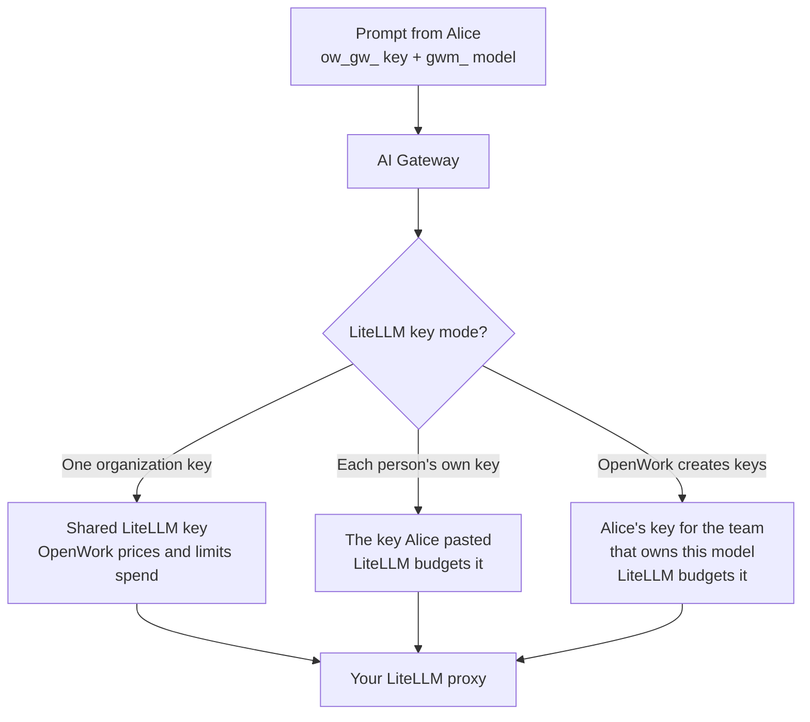

成员永远不持有提供商密钥。桌面应用（或 OpenWork Web）拿到的是**每人一把 AI Gateway 密钥**，外加这个人可用模型的清单。每条提示都带着这把密钥发往网关。网关算出该用哪个提供商、哪把上游密钥，替换进去，再把请求转发出去。

## 一把密钥进，许多密钥出

- **AI Gateway 密钥**（`ow_gw_…`）：每人每组织一把。它证明是谁在请求。它从不离开 OpenWork。
- **模型 id**（`gwm_…`）：这个人可用的每个模型都有自己的 id。它编码了模型、模型组，以及授予它的那套密钥，因此网关能准确判断该套用哪条访问规则。
- **提供商密钥**：加密存储在 Den 中，只有网关会读取。一个提供商密钥要么是组织共用的一把，要么属于某个人，比如本人的 Google 登录或本人的 LiteLLM 密钥。

## 每条提示发生了什么

桌面应用用提供商各自的 SDK，把某个提供商的请求发到该提供商的网关 URL `/api/v1/providers/{id}`。其他客户端可以不指定提供商，直接带上 `gwm_` 模型 id 调用 `/api/v1/chat/completions`、`/api/v1/responses` 或 `/api/v1/messages`；网关会从 id 里找出对应的提供商。

网关在转发前会移除这个人的 AI Gateway 密钥，因此提供商（包括你的 LiteLLM 代理）永远看不到它。它还会把 `gwm_` id 换成提供商真实的模型名，所以 LiteLLM 收到的是 `gpt-4o`，而不是 OpenWork 的 id。

## 网关选用哪把上游密钥

每个模型都是通过一套**密钥集**送达某个人的。密钥集决定了网关在请求时加载哪把上游密钥：

| 密钥集 | 每次请求使用的上游密钥 | 例子 |
| --- | --- | --- |
| 组织密钥 | 管理员保存的那一把 | OpenAI、Anthropic，以及 LiteLLM 的 “One organization key” |
| 每人的自有凭据 | 这个人自己的密钥或登录，绝不会用别人的 | Vertex 的 Google 登录，以及 LiteLLM 的 “Each person's own key” |
| OpenWork 创建的密钥 | OpenWork 为该成员和该团队创建的 LiteLLM 密钥 | LiteLLM 的 “OpenWork creates keys” |

如果某个人的自有凭据缺失，网关会拒绝该请求，应用会为那个提供商显示 **Connect** 提示。它绝不会退回使用组织密钥。

### LiteLLM 在每种模式下的表现

在 **OpenWork creates keys** 下、且按团队各一把密钥时，同时属于两个 LiteLLM 团队的人就持有两把密钥。每个模型 id 指向某一个团队的密钥集，因此对研究类模型的请求会使用研究团队的密钥，并在 LiteLLM 中记到该团队账上。

## 花费跟踪

每个请求都会连同它的 token 计数一起记录。OpenWork 是否进一步为它计价并施加用量限制，取决于是谁的密钥付的款：

- **组织密钥**：按提供商的价格计价（对 LiteLLM 来说，是从你的代理同步来的价格），并对照你的[花费上限](/zh/ai-gateway/overview)检查。
- **某个人的自有 LiteLLM 密钥，或由 OpenWork 创建的密钥**：只记录 token。生效的是 LiteLLM 自己的用户、团队和密钥预算，因此 OpenWork 不会拦截或计费这些请求。

各模式的设置方式见[使用你的 LiteLLM 代理](/zh/ai-gateway/litellm)。
