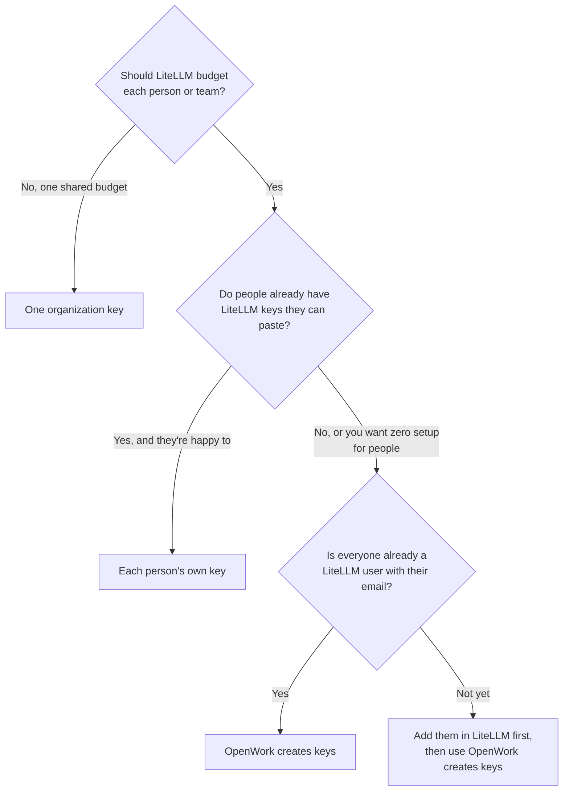
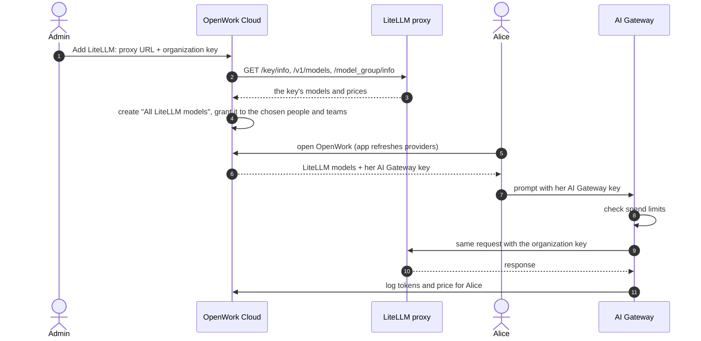
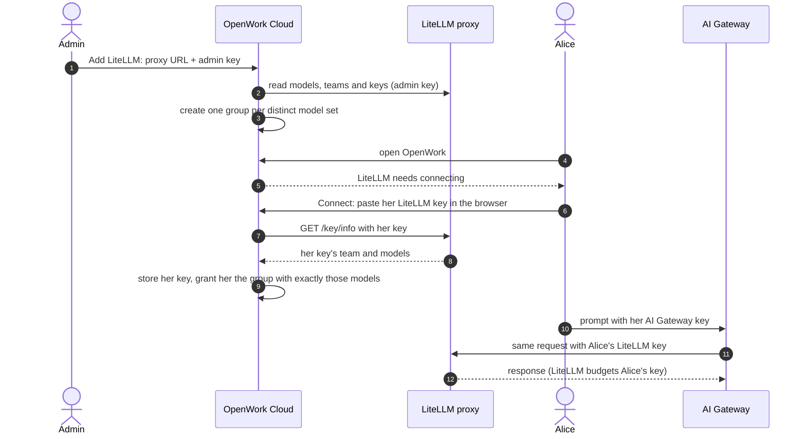
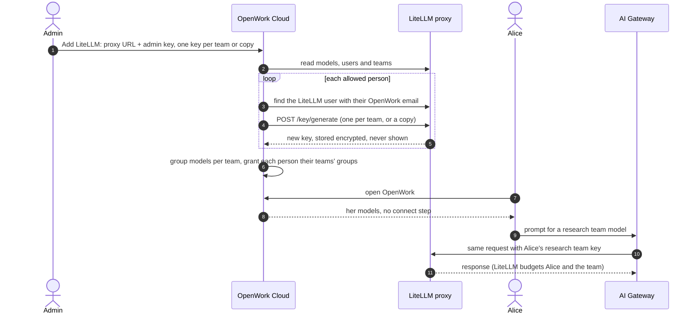
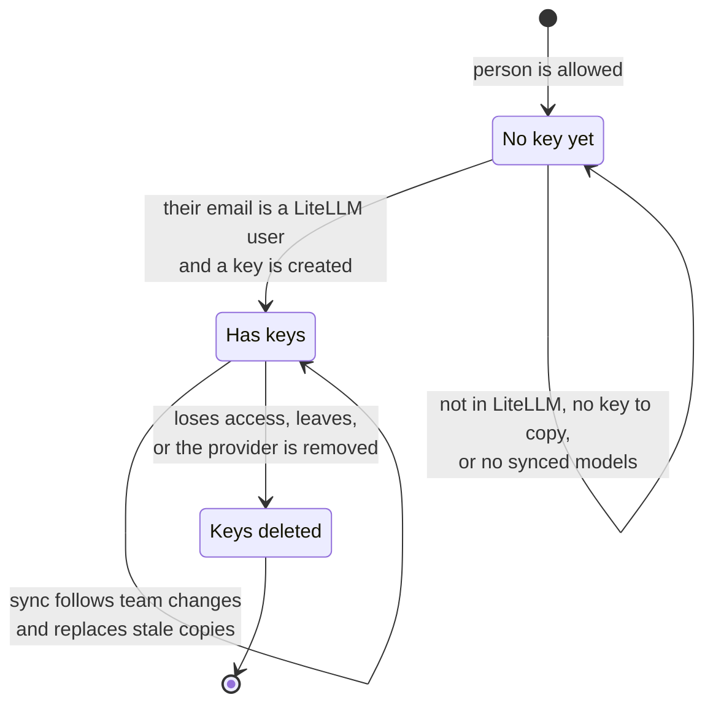

把你已经在运行的 LiteLLM 代理接入 OpenWork AI Gateway。OpenWork 会读取该代理的模型、为它们创建模型组，并通过网关把请求路由到 LiteLLM。

## 选择密钥的工作方式

OpenWork 可以用三种方式使用你的 LiteLLM 代理：

- **One organization key（组织共用一把密钥）** 你粘贴一把 LiteLLM 密钥，所有人的请求都使用它。想快速起步、一个共用的 LiteLLM 预算就够用，或者你希望由 OpenWork 跟踪花费并按人施加限制时，选这个。
- **Each person's own key（每人自己的密钥）** 每个人在 OpenWork 应用里粘贴一次自己的 LiteLLM 密钥。当大家已经有 LiteLLM 密钥，而你希望由 LiteLLM 为每个人做预算和日志时，选这个。
- **OpenWork creates a key for each person（由 OpenWork 为每人创建密钥）** 你粘贴一把 LiteLLM 管理员密钥，OpenWork 就在 LiteLLM 里按邮箱为每个人创建一把密钥。当大家本来都是 LiteLLM 用户，而你想要按人的 LiteLLM 预算、又不想任何人粘贴密钥时，选这个。

| | One organization key | Each person's own key | OpenWork creates keys |
| --- | --- | --- | --- |
| 你粘贴的密钥 | 一把所有人共用的 LiteLLM 虚拟密钥 | 一把 LiteLLM **admin key**，只用于同步模型和团队 | 一把 LiteLLM **admin key**，用于同步并为每人创建密钥 |
| 人们得到的模型 | 组织密钥能用的全部对话模型 | 每个人自己的密钥能用的模型 | 他们所在 LiteLLM 团队的模型，或他们已有密钥的一份副本 |
| 需要做的事 | 无 | 粘贴一次自己的 LiteLLM 密钥 | 无 |
| 花费跟踪与限制 | 开启。OpenWork 按 LiteLLM 的模型价格为用量计价，并施加你的用量限制 | 关闭。生效的是 LiteLLM 的预算和速率限制 | 关闭。生效的是 LiteLLM 的预算和速率限制 |

### 哪种模式合适

无论哪种模式，人们的应用里持有的都是一把 AI Gateway 密钥，绝不会有 LiteLLM 密钥。完整的请求路径见[一条提示如何到达模型](/zh/ai-gateway/how-requests-flow)。

## LiteLLM 与 OpenWork 的对应关系

| LiteLLM | OpenWork |
| --- | --- |
| 模型（`model_name`） | LiteLLM 提供商上的一个模型 |
| 团队，或某把密钥自己的模型列表 | 模型组。密钥能触达的模型完全相同的人共用一个组；OpenWork 认出他们的 LiteLLM 团队时，就用团队名命名 |
| 虚拟密钥 | 组织密钥，或某个人的自有密钥 |
| 预算与速率限制 | 由 LiteLLM 强制执行。使用组织共用密钥时，OpenWork 的用量限制同样生效 |

嵌入、图像和音频模型会被跳过。模型名称、上下文上限、价格和能力取自 LiteLLM 的 `/model_group/info`。LiteLLM 不知道的事实，OpenWork 就不会写入，例如不在其价格表中的模型。

## 设置

<Steps>
  <Step title="添加提供商">
    在 OpenWork Cloud 中前往 **AI Gateway → AI Providers → Add a provider → LiteLLM**。填入你的代理 URL，例如 `https://litellm.example.com`，带不带 `/v1` 都可以。
  </Step>
  <Step title="选择密钥模式并粘贴密钥">
    粘贴组织密钥；如果每人使用自己的密钥，则粘贴管理员密钥。OpenWork 会先和你的代理校验密钥，再保存。密钥只写不读，之后不会再显示。
  </Step>
  <Step title="选择谁获得访问权">
    使用组织共用密钥时，这些人和团队可以使用模型。使用每人自己的密钥时，他们是被允许连接自己密钥的人。
  </Step>
  <Step title="成员连接各自的密钥（仅每人自己的密钥模式）">
    在 OpenWork 应用里，人们选择 LiteLLM 提供商并点击 **Connect**。浏览器页面会索取他们的 LiteLLM 密钥。OpenWork 校验之后，授予与该密钥的模型完全匹配的那个组。
  </Step>
</Steps>

## 每种模式如何工作

### One organization key

所有人共用组织密钥的模型和 LiteLLM 预算。OpenWork 按 LiteLLM 的模型价格为每个请求计价，因此按人的报表和 OpenWork 的花费上限都和其他提供商一样生效。在 LiteLLM 里，所有用量都显示在这一把密钥下。

### Each person's own key

管理员密钥只用于读取 LiteLLM。对于不属于任何团队的密钥，LiteLLM 会列出代理上的每一个模型，但只提供其所有者有权使用的那些，所以 OpenWork 会检查所有者自己的模型列表，只授予这些。每个请求使用这个人自己的密钥，因此 LiteLLM 的用户、团队和密钥预算都会生效，LiteLLM 的日志里也能看到真实的人。OpenWork 记录 token 但不记录费用。如果 LiteLLM 之后拒绝了某把密钥，下一次同步就会撤销它，该成员会再次看到 **Connect**。

### OpenWork creates keys

人们什么都不用做。花费在 LiteLLM 中落到正确的人和团队上，而 OpenWork 记录 token 但不记录费用。

## OpenWork 创建的密钥

LiteLLM 只保存每把密钥的哈希，所以 OpenWork 读不到任何人已有的密钥。它的做法是按 OpenWork 邮箱找到每个被允许的人对应的 LiteLLM 用户，然后为他们创建新密钥。

选择每个人得到什么：

- **One per LiteLLM team**：为他们所属的每个 LiteLLM 团队各创建一把密钥，于是每个团队的模型和预算都会生效，花费也记到该团队。不属于任何团队的人得到一把密钥，沿用他们自己的 LiteLLM 用户设置。在 OpenWork 中，他们的模型按团队分组。
- **Copy their existing key**：复制他们最早那把仍有效的密钥，带上相同的团队、模型、模型别名、标签和过期时间。密钥级的预算和速率限制不会被复制，因为复制一份就等于把额度翻倍。团队和用户预算仍然生效。对于没有可复制密钥的人，请选择 **Use their teams** 或 **Show an error**。

创建出的密钥只能调用模型：它们不能管理 LiteLLM，即使这个人本身是 LiteLLM 管理员。OpenWork 从不创建 LiteLLM 用户，因为它无法知道这些人属于哪些团队。邮箱不在 LiteLLM 中的人会列在提供商页面的 **No key yet** 下，并在应用里选择 **Connect** 时看到原因。一旦 LiteLLM 管理员把他们加进去，下一次同步、或该页面上的 **Check again**，就会为他们创建密钥。

创建密钥的时机是：添加提供商时、每次同步时，以及某个被允许的人第一次打开 OpenWork 时。当某人失去访问权或离开组织时，他们的密钥会在下一次同步时在 LiteLLM 中删除。移除该提供商会删除 OpenWork 在那里创建的每一把密钥。删除整个组织不会影响你的 LiteLLM 代理。

## 保持模型同步

在 LiteLLM 中改动了模型、团队或密钥之后，请在提供商页面选择 **Sync models**。一次同步会：

- 刷新模型列表和价格
- 在每人自己的密钥模式下，重新检查每一把已连接的密钥，把人移到与其密钥相匹配的组，并撤销 LiteLLM 现在拒绝的密钥
- 在 OpenWork 创建密钥模式下，为新被允许的人创建密钥、跟随团队变动、替换原始密钥已变更的副本，并删除失去访问权的人的密钥
- 移除你不再允许连接的人的模型

如果读不到 LiteLLM，OpenWork 会保留上次同步的模型，并在提供商页面显示错误。

## 问题排查

| 你看到什么 | 原因 | 该怎么做 |
| --- | --- | --- |
| `LiteLLM rejected the key` | 该密钥不存在、被封堵或已过期 | 在 LiteLLM 中检查这把密钥，或新建一把 |
| 添加提供商时密钥被拒绝 | 代理 URL 有误、无法访问，或该密钥在这个地址上无效 | 确认用这把密钥能通过该 URL 打开 `/v1/models`。私有代理请让运维方用它的 origin 加进允许 |
| `This LiteLLM key can call models but can't manage LiteLLM` | **Each person's own key** 和 **OpenWork creates keys** 需要一把能读取用户、团队和密钥的密钥 | 使用 master key 或代理管理员密钥 |
| 某人的密钥被拒绝并提示 `no shared models` | 他的密钥触达不到任何已同步的模型 | 在 LiteLLM 中至少给这把密钥一个对话模型，然后 **Sync models** |
| 某人出现在 **No key yet** 下：不在 LiteLLM 中 | 没有任何 LiteLLM 用户使用他的 OpenWork 邮箱 | 在 LiteLLM 中用该邮箱添加他，然后 **Check again** |
| 某人出现在 **No key yet** 下：没有可复制的密钥 | 副本模式选了 **Show an error**，而他没有处于有效状态的密钥 | 在 LiteLLM 中为他创建一把密钥，或把回退方式改为 **Use their teams** |
| 某人出现在 **No key yet** 下：没有模型 | 他的团队和用户设置都没有允许任何已同步的模型 | 在 LiteLLM 中给他一个模型，然后 **Sync models** |
| 在 LiteLLM 中改动后模型不见了 | OpenWork 保留的是上次同步的列表 | 选择 **Sync models** |
| 提供商显示同步错误 | 无法读取 LiteLLM | OpenWork 会保留原有的模型。修好代理后再 **Sync models** |

## 要求与限制

- 你的代理必须能通过 HTTPS 从公网主机被 OpenWork 访问到。对于私有或自托管代理，运维方必须在 Den 和网关两侧都用 `GATEWAY_EGRESS_ALLOWED_ORIGINS` 放行它的 origin。
- 想更换代理 URL 或密钥模式，请添加一个新的 LiteLLM 提供商。
- 不支持通过你的身份提供商登录（LiteLLM 的 JWT auth）。请使用 LiteLLM 虚拟密钥。
- API：`POST /v1/inference-providers/litellm`（mode 为 `org`、`member` 或 `issued`）、`POST /v1/inference-providers/{id}/litellm/sync`、用于替换密钥或更改密钥创建方式的 `PATCH /v1/inference-providers/{id}/litellm`，以及用于个人自有密钥的 `PUT /v1/inference-providers/{id}/litellm/member-key`。
